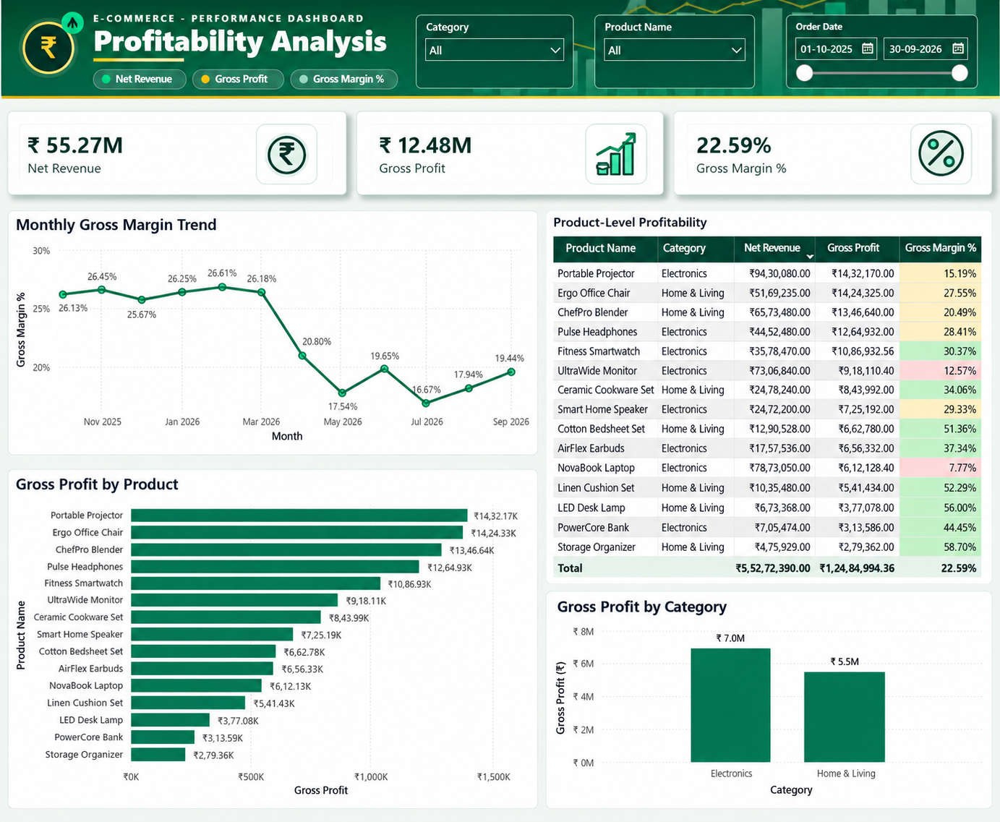

<div align="center">

# E-Commerce Profitability Analysis
### SQL · MySQL · Power BI

**Turning transaction data into actionable profitability insights**


</div>

---

## Overview

This portfolio project examines e-commerce sales and product profitability across **October 2025–September 2026**. Using MySQL for data analysis and Power BI for interactive reporting, the project explores how revenue, discounts, and product costs relate to gross profit and gross margin.

The goal is to go beyond reporting sales totals and identify products and categories that may need further commercial investigation.

> **Dataset note:** The dataset is synthetic and created for analytical practice. Findings describe this dataset only and should not be interpreted as real company performance.

## Business Questions

- How do net revenue, gross profit, and gross margin change over time?
- Which product categories contribute the most gross profit?
- Which products have relatively low gross margins?
- What changed in Electronics profitability between March and May 2026?
- Which pricing and cost metrics should be investigated further?

## Tools & Skills

| Tool | How it was used |
|---|---|
| **MySQL 8.0** | Data exploration, joins, aggregations, date-based analysis, profitability calculations |
| **SQL** | `GROUP BY`, conditional analysis, weighted averages, product/month comparisons |
| **Power BI Desktop** | Data modeling, interactive visuals, slicers, dashboard design |
| **DAX** | Measures for net revenue, gross profit, and gross margin |

## Data Model

The database contains five tables:

| Table | Purpose |
|---|---|
| `orders` | Order-level details, dates, customer IDs, and status |
| `order_items` | Product quantities, unit selling prices, discounts, and unit costs |
| `products` | Product names and categories |
| `returns` | Return-related records |
| `marketing_spend` | Marketing expenditure records |

The current Power BI dashboard focuses on `orders`, `order_items`, and `products`.

### Relationships

```text
orders                         products
  order_id (1)                    product_id (1)
        \                           /
         \                         /
          order_items (*)
```

- `orders[order_id]` → `order_items[order_id]`
- `products[product_id]` → `order_items[product_id]`

## Metric Definitions

**Net Revenue**

```text
SUM(quantity × (unit_price − discount_per_unit))
```

**Gross Profit**

```text
Net Revenue − Cost of Goods Sold
```

where:

```text
Cost of Goods Sold = SUM(quantity × unit_cost)
```

**Gross Margin %**

```text
Gross Profit ÷ Net Revenue
```

Gross margin is calculated as total gross profit divided by total net revenue, rather than as a simple average of product-level margin percentages.

## Power BI Dashboard

The one-page dashboard provides an interactive view of overall and product-level profitability.

**Included visuals**
- KPI cards: Net Revenue, Gross Profit, Gross Margin %
- Line chart: monthly gross margin trend
- Column chart: gross profit by product category
- Product-level profitability table with conditional formatting
- Horizontal bar chart: gross profit by product
- Slicers: order date, category, and product

### Dashboard Preview




## Key Findings

### 1. Overall profitability should be monitored alongside revenue

The full-period dashboard previously showed approximately **₹55.27M in net revenue**, **₹12.48M in gross profit**, and **22.59% gross margin**. These headline values provide context, while the monthly trend helps reveal changes hidden by full-period totals.

### 2. Category contribution differs from category margin

In the full-period analysis, Electronics generated approximately **₹7.0M** in gross profit compared with approximately **₹5.5M** for Home & Living. Higher gross profit does not necessarily mean a higher gross margin; both metrics should be reviewed when evaluating category performance.

### 3. Some products have relatively low gross margins

The product-level analysis highlighted:
- **NovaBook Laptop:** approximately **7.77%** gross margin
- **UltraWide Monitor:** approximately **12.57%** gross margin

These products are candidates for further review of realized selling price, discounts, and unit costs. A low margin alone does not establish why profitability is weak.

### 4. Electronics profitability weakened between March and May 2026

The SQL investigation of Electronics found:

| Metric | March 2026 | May 2026 |
|---|---:|---:|
| Gross profit | ₹688,769 | ₹305,948 |
| Gross margin | 23.77% | 12.05% |

This represents a gross-profit decline of approximately **55.6%** and a gross-margin decrease of **11.72 percentage points**.

Additional checks found that weighted-average discounts increased from March to April across the eight Electronics products examined. Unit costs also rose by approximately **7.8%–8.5% from March to May** for four products: NovaBook Laptop, UltraWide Monitor, Pulse Headphones, and Fitness Smartwatch.

These observations identify discounting and unit costs as areas to investigate; they do **not** prove that either factor caused the decline.

## Business Recommendations

1. **Review discount effectiveness.** Compare discount levels with realized selling price, gross profit, and margin at product/month level.
2. **Investigate unit-cost changes.** Validate cost movements for products with declining profitability before changing prices or suppliers.
3. **Prioritize low-margin products.** Review NovaBook Laptop and UltraWide Monitor using realized price, discount, and unit-cost trends.
4. **Monitor both profit and margin.** Use gross profit to understand total contribution and gross margin to understand profitability relative to revenue.
5. **Compare categories over time.** Avoid relying only on full-period category totals when making pricing or merchandising decisions.

## Suggested Repository Structure

```text
ecommerce-profitability-analysis/
├── README.md
├── sql/
│   └── profitability_analysis.sql
├── powerbi/
│   └── Ecommerce Profitability Dashboard.pbix
└── images/
    └── E-Commerce_Profitability_Dashboard.png
```


## How to Explore the Project

1. Import the dataset into MySQL 8.0.
2. Run the SQL analysis scripts in the `sql/` directory.
3. Open the Power BI `.pbix` file in Power BI Desktop.
4. Configure the MySQL connection if prompted.
5. Use the date, category, and product slicers to explore the dashboard.


## Limitations

- The dataset is synthetic and does not represent actual business results.
- The analysis identifies patterns and associations; it does not establish causation.
- Returns and marketing spend are part of the database but are not included in the current core dashboard analysis.

## Conclusion

This project demonstrates a practical analytics workflow: structuring transactional data in MySQL, calculating profitability metrics with SQL and DAX, and presenting results through an interactive Power BI dashboard. It emphasizes business interpretation as well as technical implementation.

---

<div align="center">

**Built as a Data Analyst portfolio project**

</div>
